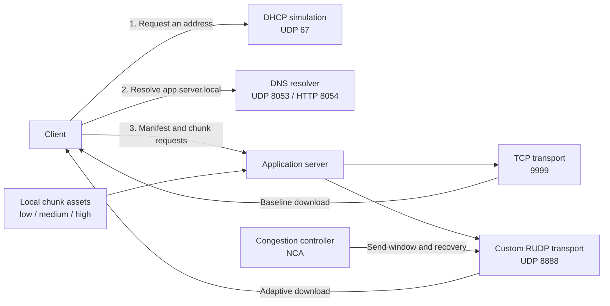

<div align="center">

# StreamLink RUDP

### Reliable delivery. Adaptive quality. Built on UDP.

A Python networking lab that connects service discovery, custom transport reliability,
and adaptive media-chunk delivery in one end-to-end system.

**Python 3 · Socket Programming · Reliable UDP · Congestion Control**

[Quick start](#quick-start) · [Architecture](#architecture) · [Protocol notes](docs/PROTOCOL.md) · [Validation](docs/VALIDATION.md)

</div>

---

## The idea

What does it take to deliver a file reliably when UDP does not guarantee delivery or order?

StreamLink explores that question with a custom transport layer: binary packets, sequence
numbers, acknowledgements, a sliding send window, retransmission, and congestion control.
A client discovers the application server through local DHCP/DNS simulations, then downloads
the same set of media chunks over TCP and custom RUDP.

The RUDP client also measures transfer throughput and selects a quality tier before each chunk.
This makes the project a hands-on exploration of how application, transport, and discovery
layers interact.

## What is implemented

- **Service discovery:** Discover → Offer → Request → ACK exchange, followed by a local domain lookup.
- **Two transport paths:** TCP as a baseline and a custom reliable transport built over UDP.
- **Binary packet format:** a 20-byte header with sequence/ACK numbers, flags, receive window,
  checksum, and payload length.
- **Sliding-window sender:** separate sending and ACK-processing threads coordinate through
  a condition variable.
- **Loss recovery:** timeout retransmission and fast retransmit after three duplicate ACKs.
- **Congestion and flow control:** slow start, additive window growth, timeout reduction,
  and a send allowance bounded by the advertised receive window.
- **Out-of-order reception:** a bounded packet buffer and cumulative acknowledgements.
- **Adaptive chunk selection:** `low`, `medium`, or `high` based on the previous chunk's measured throughput.
- **Network simulation:** 5% artificial outbound packet loss and up to 50 ms random send delay.
- **HTTP name lookup:** an optional JSON resolver endpoint alongside the UDP resolver.

This is an educational networking prototype. DHCP and DNS use custom text messages; the
HTTP lookup endpoint uses plain HTTP. The media workflow is DASH-inspired and transfers JPEG
chunks using a JSON manifest, rather than implementing an MPEG-DASH player or an MPD manifest.

## Architecture



All default listeners bind to `127.0.0.1`. The DHCP simulation records an offered address
inside the client; it does not configure the computer's network interface.

## Quick start

Use a modern Python 3 installation. Local validation was performed with **Python 3.13.5**.
There are **no third-party dependencies**.

```sh
git clone https://github.com/Ori-Marom/streamlink-rudp.git
cd streamlink-rudp
```

Run the following commands in **four separate terminals**, all opened in the repository root.
On Windows, `py -3` can replace `python`; on other systems, use `python3` if needed.

**1 — Start address allocation**

```sh
python dhcp_server.py
```

**2 — Start name resolution**

```sh
python dns_server.py
```

**3 — Start the application server**

```sh
python app_server.py
```

**4 — Run the client**

```sh
python client.py
```

The client performs discovery, downloads all three files over TCP at `low` quality, and
then downloads them over RUDP with adaptive quality. Received files are written to
`downloads/tcp_frame*.jpg` and `downloads/rudp_frame*.jpg`. Stop each server with `Ctrl+C`.

### Assets

The application server creates missing files under `assets/{low,medium,high}/` on startup.
These are small placeholder JPEG byte sequences for exercising the transfer path; they
are not a sample video or a visual-quality benchmark. To demonstrate meaningful quality
adaptation, supply your own `frame1.jpg`, `frame2.jpg`, and `frame3.jpg` in each tier,
with different sizes or compression levels. Existing files are preserved.

### Port 67 is unavailable?

Some systems restrict or already use this port. Choose an unused unprivileged port such as
`6767` and change **both** the default `DHCPServer` port in `dhcp_server.py` and
`Client.dhcp_server_address` in `client.py`. The test harness uses temporary unprivileged ports.

## Project map

```text
streamlink-rudp/
├── app_server.py          # Manifest, assets, TCP and RUDP listeners
├── client.py              # Discovery, downloads and adaptive quality selection
├── dhcp_server.py         # Address-pool simulation and DORA messages
├── dns_server.py          # UDP resolver and optional HTTP/JSON endpoint
├── RUDP_core.py           # Header serialization, packets and checksum
├── RUDP_connection.py     # Handshake, windowed transmission and recovery
├── nca.py                 # Congestion and receive-window controller
├── rudp_packet.py         # Alternate packet wrapper retained for compatibility
├── tests/
│   ├── test_protocol.py   # Packet and service regression tests
│   └── smoke.py           # Local end-to-end transfer check
├── docs/
│   ├── PROTOCOL.md        # Message flow, wire format and design boundaries
│   └── VALIDATION.md      # Reproducible checks and results
├── requirements.txt       # Standard library only
└── .gitignore             # Excludes generated assets, downloads and local files
```

The active server/client import `RUDPPacket` from `RUDP_core.py`. The separate
`rudp_packet.py` wrapper is retained from the supplied project and is not on that runtime path.

## Validate locally

```sh
python -m unittest discover -s tests -v
python tests/smoke.py
```

The first command checks packet round trips, corruption rejection, DHCP/DNS behavior, and
congestion-control transitions. The second starts isolated local services and verifies that
three TCP downloads and three RUDP downloads exactly match multi-packet source data.
It disables simulated loss and delay to give a deterministic baseline.

See [validation notes](docs/VALIDATION.md) for the scope of these checks.

## Current boundaries

- The UDP application listener serves one chunk transfer at a time; it is not a multi-client dispatcher.
- Data packets can be retransmitted, but handshake/control messages do not yet have a complete
  bounded retry strategy. Randomly dropped SYN/FIN packets can interrupt or delay a demo.
- The client can leave a partial file after a receive timeout; completion logging alone is not
  an integrity guarantee. The smoke check compares the actual bytes.
- Receiver-side buffering uses cumulative ACKs; the sender does not maintain a full selective-ACK map.
- DHCP allocations are in memory and are not reclaimed until restart.
- There is no encryption, peer authentication, or production hardening. The server currently
  keeps its main thread alive with a busy loop.

## Engineering directions

Natural next steps include reliable control-message retries, strict packet-length and peer
validation, bounded transfer cancellation, multi-client socket routing, and repeatable
benchmarks under controlled loss and delay. A real video player and standards-compliant
MPEG-DASH/DoH support would be separate extensions.

---

Built by **Ori Marom** · A practical exploration of network protocol design in Python.
