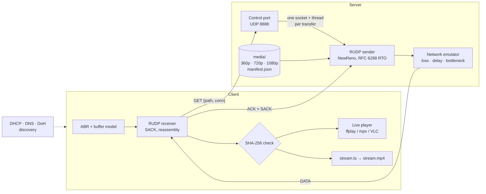
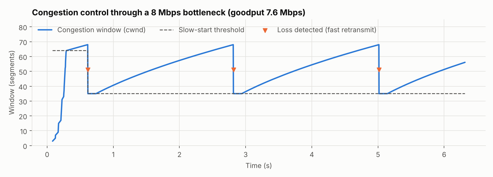
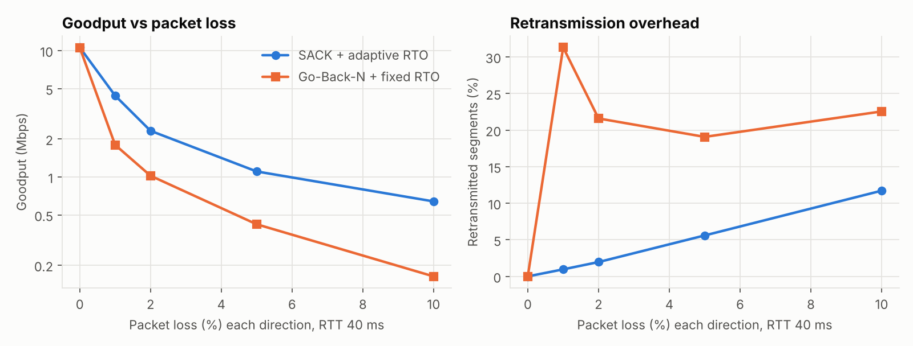
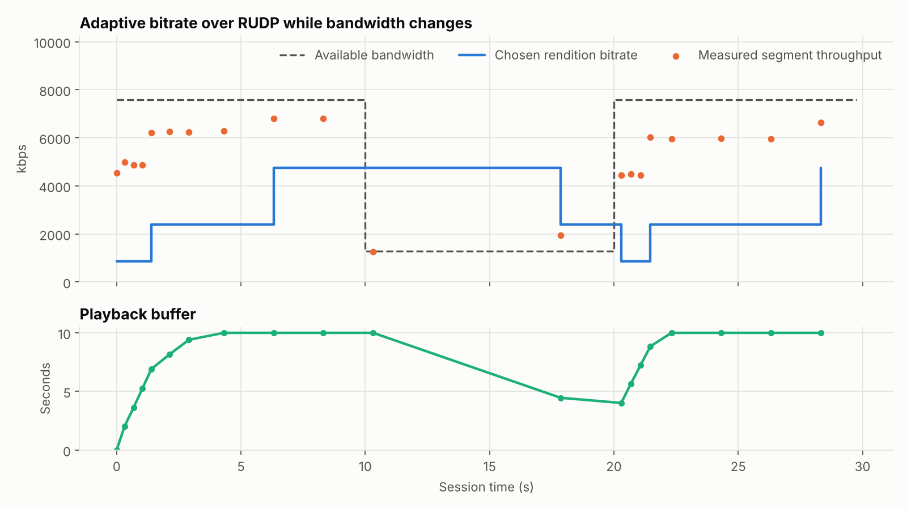

<div align="center">

# StreamLink RUDP

### Adaptive video streaming over a reliable transport built from scratch on UDP

[](https://github.com/Ori-Marom/streamlink-rudp/actions/workflows/tests.yml)


**SACK · RFC 6298 RTO · NewReno congestion control · Adaptive bitrate · Network emulator**

[Quick start](#quick-start) · [How it works](#how-it-works) · [Results](#results) · [Protocol spec](docs/PROTOCOL.md) · [Validation](docs/VALIDATION.md)

</div>

---

Encode a real video into three qualities, serve it over a custom reliable-UDP
protocol, and watch it play while it downloads, with the quality adapting
live to the network. Everything below the video codec is implemented here in
plain Python: the wire format, the handshake, selective acknowledgements,
retransmission timers, congestion control, the adaptive-bitrate player logic,
and a network emulator to stress all of it.

```console
$ python -m streamlink_rudp demo --play
[1/4] Preparing a 30s test video in 3 qualities (ffmpeg)...
[2/4] Starting DHCP, DNS and the media server...
[3/4] Discovery
      DHCP: leased 192.168.1.100
      DNS:  app.server.local -> 127.0.0.1
[4/4] Streaming over RUDP with adaptive bitrate (playing live)
  seg   0    360p  ###                     6880 kbps measured   buffer   2.0s
  seg   1    720p  ##########              7104 kbps measured   buffer   3.4s
  seg   2   1080p  ###################     7012 kbps measured   buffer   4.2s
  ...                                       ← bandwidth drops to 1.2 Mbps
  seg   7    360p  ###                     1121 kbps measured   buffer   5.1s
  ...
  Downloaded   15 segments, 13.4 MB in 31.2s over RUDP
  Bitrate      avg 2973 kbps, 4 quality switches
  Playback     startup 0.31s, 0 stalls (0.0s)
  Saved        downloads/stream.mp4
```

## Highlights

- **A real reliable transport**, not stop-and-wait: 20-byte binary header with
  connection IDs and random ISNs, sliding window, **selective acknowledgements**,
  **RFC 6298** adaptive retransmission timeout with Karn's algorithm and backoff,
  **NewReno** slow start / congestion avoidance / fast recovery, receive-window flow
  control, and retransmitted SYN/FIN with a TIME_WAIT-style close.
- **Real video**: `ffmpeg` encodes any video (or a generated test pattern) into
  360p/720p/1080p MPEG-TS segments with aligned keyframes, so the client can switch
  quality at every segment boundary. Each segment is checked against a SHA-256 in
  the manifest.
- **Adaptive bitrate** with a throughput + buffer hybrid rule, a playback-buffer
  model that counts startup delay and stalls, **live playback** (ffplay, mpv or VLC)
  and an MP4 at the end.
- **Concurrent clients**: the server gives every transfer its own socket and
  thread, and caches per-client RTT/ssthresh between transfers (RFC 2140).
- **A network emulator** (like `tc netem`, in user space): loss, delay, jitter,
  reordering, duplication, corruption, and a bandwidth bottleneck with a drop-tail
  queue that changes over time.
- **Measured, not claimed**: 40 tests (including a bit-flip test on every header
  bit and a full video round trip over a lossy link), CI on Linux, Windows and
  macOS, and benchmarks that regenerate every chart below.

## Quick start

Requirements: **Python 3.10+** and **[ffmpeg](https://ffmpeg.org/download.html)**
on your PATH (`ffplay`, which ships with ffmpeg, is used for live playback).
No Python packages are needed.

```sh
git clone https://github.com/Ori-Marom/streamlink-rudp.git
cd streamlink-rudp
python -m streamlink_rudp demo --play      # everything in one command
python -m streamlink_rudp demo --quick     # small video, ~15 seconds, no player needed
```

### Stream your own video

```sh
# 1. Encode into 360p / 720p / 1080p segments (or --synthetic for a test pattern)
python -m streamlink_rudp prepare --input my_video.mp4 --out media

# 2. Serve it; optionally make the network worse
python -m streamlink_rudp serve --media media --delay 20 --loss 0.01 --bw-profile 0:8000,20:1500,40:8000

# 3. In another terminal: watch it adapt (and save downloads/stream.mp4)
python -m streamlink_rudp stream --play
```

To stream across machines, start the server with `--host 0.0.0.0` and point the
client at it with `--server <ip>`. `stream --transport tcp` downloads the same
segments over TCP for comparison; `stream --rendition 720p` disables adaptation.
Every command has `--help`.

## How it works



1. **Prepare.** `ffmpeg` encodes the video once per rendition with a keyframe
   forced every 2 s and cuts it into MPEG-TS segments. `manifest.json` records
   each segment's duration, size and SHA-256, and each rendition's measured bitrate.
2. **Request.** For every segment the client sends a small JSON GET with a random
   32-bit connection ID. The server answers from a fresh UDP socket.
3. **Transfer.** SYN → SYN-ACK → windowed DATA with ACK + SACK → FIN → ACK. Losses
   are found from SACK holes or the retransmission timer; the congestion window
   follows NewReno. [Full protocol spec →](docs/PROTOCOL.md)
4. **Adapt.** The client measures each segment's throughput, tracks its playback
   buffer, and picks the next segment's quality: up one step at a time when there
   is headroom and buffer, straight down when bandwidth falls.
5. **Play and save.** Verified segments go to the player immediately and to
   `stream.ts`, which is packaged as `stream.mp4` at the end.

## Results

All numbers come from `python -m streamlink_rudp bench`, which regenerates these
charts and [`docs/images/results.json`](docs/images/results.json).

### Congestion control through a bottleneck



A 6 MB transfer through an emulated **8 Mbps** link with 40 ms RTT and a 40 ms
drop-tail queue. Slow start ramps up exponentially until the queue overflows,
then the window follows the classic NewReno sawtooth: halve on loss, grow by
one segment per RTT. CWND_SUMMARY

### SACK + adaptive RTO vs Go-Back-N + fixed timeout



LOSS_TABLE

### Adaptive bitrate while the network changes



ABR_SUMMARY

## Project layout

```text
streamlink_rudp/
├── packet.py       # 20-byte header, checksum, SACK and SYN payloads
├── transport.py    # Sender (window, SACK loss detection, RTO, NewReno) and receiver
├── rtt.py          # RFC 6298 estimator + fixed-timeout baseline
├── congestion.py   # NewReno: slow start, congestion avoidance, fast recovery
├── netem.py        # user-space network emulator
├── media.py        # ffmpeg encoding, segmenting, manifest, MP4 packaging
├── abr.py          # adaptive bitrate rule + playback buffer model
├── server.py       # multi-client media server (RUDP + TCP)
├── client.py       # adaptive streaming client, integrity checks, live player
├── discovery.py    # DHCP-style allocator, DNS resolver, DNS over HTTP
├── bench.py        # experiments and charts
└── cli.py          # python -m streamlink_rudp ...
tests/              # unit, transport, system and video end-to-end tests
docs/               # protocol spec, validation notes, charts
```

## Run the tests

```sh
python -m unittest discover -s tests -v     # ~25 s; video tests are skipped without ffmpeg
python -m streamlink_rudp bench --quick     # quick benchmark (charts need: pip install matplotlib)
```

## Limits

This is a learning and portfolio project, not a production CDN: there is no
encryption or authentication, objects are held in memory while they transfer,
and reordering deeper than three packets causes a spurious fast retransmit.
The DHCP and DNS services model the message flows of the real protocols with
simple text messages. See [docs/PROTOCOL.md](docs/PROTOCOL.md#7-known-limits).

---

Built by **Ori Marom**.
