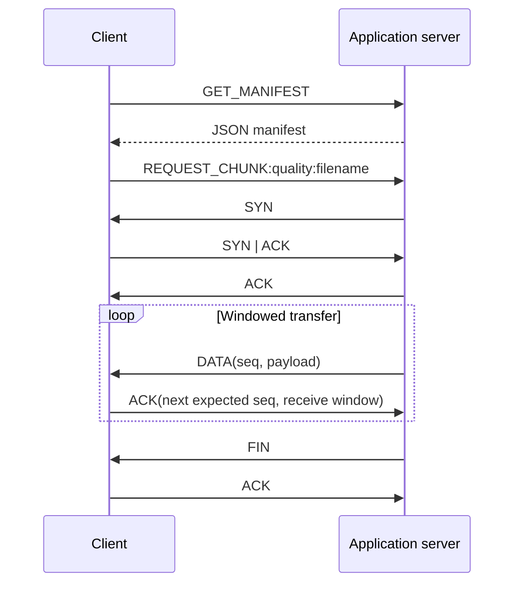

# Protocol and design notes

## Discovery

The DHCP simulation listens on loopback UDP port 67. A single client socket sends
`DHCP_DISCOVER`, receives `DHCP_OFFER:<ip>`, sends `DHCP_REQUEST:<ip>`, and receives
`DHCP_ACK:<ip>` when the requested address matches that socket's allocation.
An exhausted pool returns `DHCP_OFFER:NONE`; a mismatched request returns `DHCP_NAK:<ip>`.
The pool is `192.168.1.100` through `192.168.1.102` and is held in memory.

The UDP DNS simulation accepts a domain as UTF-8 text on port 8053. It returns
`DNS_RESPONSE:127.0.0.1` for `app.server.local` or `DNS_RESPONSE:NOT_FOUND` otherwise.
An optional HTTP server listens on port 8054 and accepts a `name` query parameter,
for example `/dns-query?name=app.server.local`. Its JSON resembles a DNS lookup response,
but the endpoint is plain HTTP, has no TLS, and is not standards-compliant DNS-over-HTTPS.

## Application messages

`GET_MANIFEST` returns a JSON object containing `video_name`, `qualities`, `files`,
and nested `file_sizes[quality][filename]` values. The TCP response starts with a
four-byte unsigned big-endian JSON length. The UDP response is a single datagram.

`REQUEST_CHUNK:<quality>:<filename>` requests one asset. The server validates both
the quality and filename against fixed allowlists. TCP sends raw file bytes and closes
the connection; the client opens a new connection for each chunk. UDP switches from
text requests to the binary RUDP exchange for the requested file.

## RUDP wire format

`RUDPHeader.HEADER_FORMAT` is `!LLHLHL`: network byte order and a fixed **20-byte** header.
The fields, in wire order, are:

1. Sequence number — unsigned 32-bit packet index.
2. Acknowledgement number — unsigned 32-bit next expected packet index.
3. Flags — unsigned 16-bit bitmask.
4. Receive window — unsigned 32-bit byte allowance.
5. Checksum — unsigned 16-bit Internet checksum.
6. Payload length — unsigned 32-bit byte count.

Flags are `SYN=0x01`, `ACK=0x02`, `FIN=0x04`, `DATA=0x08`, and `ERR=0x10`.
Data segmentation uses a maximum payload of 1,400 bytes. The checksum covers the
header with its checksum field zeroed plus the payload, padding an odd byte count
for calculation. It detects accidental corruption; it is not cryptographic authentication.

The Python constructor's last two argument positions differ from wire order. Decoding
therefore explicitly maps named fields rather than passing the unpacked tuple positionally.

## Windowing and recovery

`NCA` starts with `cwnd=1` packet and `ssthresh=64`. Fresh ACKs increase `cwnd` by one
in slow start, then by approximately `1/cwnd` in congestion avoidance. The permitted
byte window is `min(cwnd * 1400, rwnd)`; the sender converts that to packet slots.
The sender currently forces a minimum of one slot, so a zero receive window does not
fully pause it. The client advertises a fixed 65,535-byte window.

Three duplicate ACKs trigger fast retransmit and reduce the slow-start threshold.
A timeout resets `cwnd` to one and rewinds transmission to the oldest unacknowledged
packet. A receiver thread processes ACKs while the sending thread fills the window.

The client buffers up to a 64-packet sequence range for out-of-order packets. ACKs
are cumulative. This combines receiver-side selective buffering with retransmission
from the send base, rather than implementing a full selective-repeat sender.

## Adaptive quality

The first RUDP request chooses `medium`. Subsequent requests use the last measured
throughput in **bytes per second**:

- Below 8,000: `low`.
- From 8,000 to below 25,000: `medium`.
- At least 25,000: `high`.

The measurement includes the receive/close interval and can be noisy for tiny files.
All generated placeholders are identical across tiers, so they validate transport
plumbing rather than a quality/bitrate tradeoff. `NCA.recommend_quality()` is a separate
helper; the active client chooses quality using its own throughput thresholds.

## Reliability boundaries

The server's simulated send path randomly drops 5% of its outbound packets, including
SYN and FIN, and optionally sleeps for up to 50 ms before sending. The handshake does
not retry a lost SYN; FIN waits for a response but is not retransmitted. The ACK receiver
does not currently verify peer identity or checksums. The client validates checksums
on its main receive path, but validation is not consistent across all control paths.

There is no transfer identifier, persistent session state, robust cancellation deadline,
or multiplexing of simultaneous UDP clients. Treat the implementation as a local lab.
