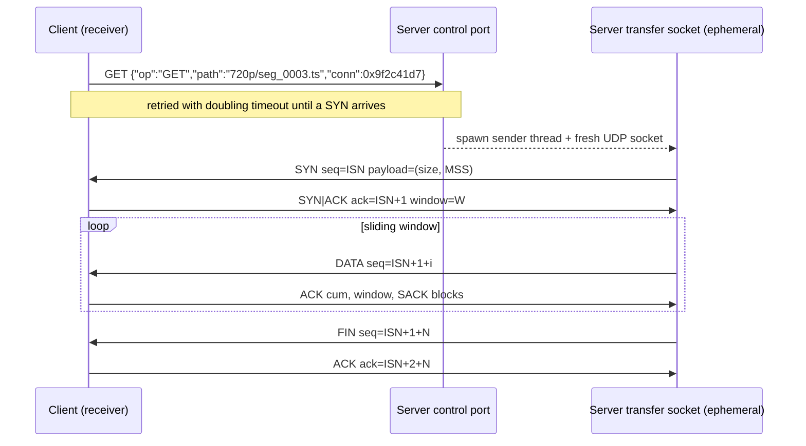

# Protocol specification

StreamLink moves every object (the manifest and each media segment) as one
*transfer* over a reliable, congestion-controlled protocol built on UDP. This
document is the reference for the wire format and the state machines; the code
lives in [`streamlink_rudp/packet.py`](../streamlink_rudp/packet.py) and
[`streamlink_rudp/transport.py`](../streamlink_rudp/transport.py).

## 1. Transfer lifecycle



* **Connection ID.** The client picks a random 32-bit `conn` per transfer. Every
  packet carries it, and both ends drop packets with the wrong ID. Together with
  the per-transfer socket this guarantees a delayed packet from an earlier
  transfer can never be written into a later one.
* **Random ISN.** The sender picks a random initial sequence number, so sequence
  numbers are not predictable and never restart at 0 for consecutive transfers.
* **Per-transfer sockets.** The server answers each request from a new ephemeral
  UDP socket and thread (like TFTP), so many clients and transfers run in
  parallel without sharing a socket. A retransmitted GET for a transfer that is
  already running is recognised by `(client address, conn)` and ignored.
* **Every control step is retransmitted.** GET is retried by the client, SYN and
  FIN by the sender with the RTO and exponential backoff. A lost SYN-ACK is
  repaired because a repeated SYN makes the receiver resend it.
* **TIME_WAIT.** After it has every byte, the receiver keeps acknowledging
  retransmissions until the sender has been quiet for a short period, so the
  sender is never left retransmitting into the void because the last ACK was lost.

## 2. Wire format

All fields are big-endian. Header size is fixed at **20 bytes**.

| Offset | Size | Field | Meaning |
|---:|---:|---|---|
| 0 | 4 | `conn_id` | Transfer identifier chosen by the client |
| 4 | 4 | `seq` | Sequence number, counted in segments, wraps at 2³² |
| 8 | 4 | `ack` | Cumulative ACK: next segment the receiver expects |
| 12 | 1 | `flags` | `SYN 0x01`, `ACK 0x02`, `FIN 0x04`, `DATA 0x08`, `RST 0x10` |
| 13 | 1 | reserved | 0 |
| 14 | 2 | `window` | Receive window in segments |
| 16 | 2 | `checksum` | RFC 1071 Internet checksum over header + payload |
| 18 | 2 | `length` | Payload length; must equal the bytes actually received |

Payloads by packet type:

* **SYN:** `total_bytes (u64)`, `mss (u16)`. The receiver sizes its buffer from these.
* **DATA:** up to `MSS` bytes (1200 by default, so datagrams fit a 1500-byte MTU).
* **ACK:** up to 4 SACK blocks, each `start (u32)`, `end (u32)` meaning segments
  `[start, end)` were received above the cumulative ACK. The block containing the
  most recently received segment comes first (RFC 2018).

A datagram is rejected if it is shorter than the header, if `length` does not
match, or if the checksum fails. A test flips every single bit of a packet and
checks that each flip is detected.

## 3. Sender

### Window and transmission

The sender may have `min(cwnd, rwnd)` segments in flight. On every pass it first
retransmits segments marked lost, lowest first, and then sends new data.
In-flight accounting follows RFC 6675's *pipe*: a segment stops counting once
it is cumulatively ACKed, SACKed or marked lost, and counts again when retransmitted.

### Retransmission timeout (RFC 6298)

* `SRTT`, `RTTVAR` and `RTO = SRTT + max(G, 4·RTTVAR)`, with α = 1/8 and β = 1/4.
* **Karn's algorithm:** RTT samples are never taken from retransmitted segments.
* Exponential backoff on expiry, reset on the next new ACK.
* Lower bound of 200 ms (as in Linux) rather than RFC's 1 s; upper bound 60 s.
* On expiry: `ssthresh = flight/2`, `cwnd = 1`, every un-SACKed outstanding
  segment is marked lost and resent in slow start.

### Loss detection

* **SACK:** an un-SACKed segment with at least 3 SACKed segments above it is lost
  (DupThresh = 3). A segment that was already retransmitted is only marked again
  after about 1.25 × SRTT, so a slow retransmission isn't mistaken for a new loss.
* **Duplicate ACKs:** 3 duplicate ACKs mark the first unacknowledged segment lost.

### Congestion control (NewReno, RFC 5681 / RFC 6582)

| Event | Reaction |
|---|---|
| New data ACKed, `cwnd < ssthresh` | Slow start: `cwnd += acked` |
| New data ACKed, `cwnd ≥ ssthresh` | Congestion avoidance: `cwnd += acked / cwnd` |
| Loss detected (SACK / 3 dup ACKs) | Fast recovery: `ssthresh = cwnd = flight/2`; at most once per window |
| ACK beyond the recovery point | Leave fast recovery |
| RTO expiry | `ssthresh = flight/2`, `cwnd = 1` |

### Path cache (RFC 2140)

The server remembers the last `SRTT`, `RTTVAR` and `ssthresh` per client address
and seeds the next transfer with them. Consecutive segments therefore start with
a realistic RTO and a known slow-start threshold, instead of 1 s and no history.

### Baseline mode

`SenderConfig(sack=False, adaptive_rto=False)` (CLI: `serve --no-sack --fixed-rto`)
ignores SACK, resends the whole outstanding window after 3 duplicate ACKs
(Go-Back-N) and uses a fixed 1 s timeout. It exists so the benchmarks can show
what SACK and adaptive RTO are worth.

## 4. Receiver

* Accepts segments up to `buffer_segments` (default 1024) beyond the cumulative
  ACK; out-of-order segments are kept and delivered once the gap fills.
* ACKs every DATA packet with the cumulative ACK, the free window and SACK blocks.
* Counts duplicates and out-of-order arrivals for statistics.
* Raises an error after 10 s without any packet from the sender.

## 5. Application layer

| Request | Transport | Reply |
|---|---|---|
| `{"op":"GET","path":P,"conn":ID}` | UDP control port (default 8888) | RUDP transfer of the file, or `{"conn":ID,"error":...}` |
| `{"op":"GET","path":P}` + newline | TCP (default 9999) | `{"ok":true,"size":N}` + newline + N bytes, or `{"ok":false,"error":...}` |

Paths are resolved inside the media root; anything outside it (`../`, absolute
paths) or missing is rejected.

### Manifest

`manifest.json` lists renditions sorted by bandwidth. Every rendition has the
same number of segments with keyframes on the same boundaries, so the client can
switch rendition at any segment:

```json
{
  "version": 1,
  "title": "synthetic",
  "container": "mpegts",
  "segment_duration": 2.0,
  "duration": 40.0,
  "renditions": [
    {
      "id": "360p", "width": 640, "height": 360,
      "nominal_kbps": 796, "bandwidth": 812345,
      "segments": [
        {"path": "360p/seg_0000.ts", "duration": 2.0, "size": 203396,
         "sha256": "9f1c..."}
      ]
    }
  ]
}
```

The client verifies `size` and `sha256` of every segment before it is written to
the output or handed to the player, so the result is checked end to end and not
only by the per-packet checksum.

### Adaptive bitrate

Before each segment the client picks a rendition from the harmonic mean of the
last 4 segment throughputs (with a 0.8 safety factor) and its playback buffer:
it steps up at most one rendition at a time and only with at least 6 s
buffered, drops immediately when throughput falls, and goes to the lowest
rendition below 2 s of buffer. See [`abr.py`](../streamlink_rudp/abr.py).

## 6. Discovery

Optional and deliberately simple text protocols that model the flow, not the
binary formats, of the real ones:

* **DHCP-style DORA** on UDP 6767: `DHCP_DISCOVER` → `DHCP_OFFER:<ip>` →
  `DHCP_REQUEST:<ip>` → `DHCP_ACK:<ip>` (or `DHCP_NAK`), plus `DHCP_RELEASE`.
* **DNS** on UDP 8053: query `app.server.local` → `DNS_RESPONSE:<ip>`.
* **DNS over HTTP** on TCP 8054: `GET /dns-query?name=...` → JSON in the style of
  the `application/dns-json` API.

## 7. Known limits

* No encryption or authentication; any host that can reach the server can read the media.
* The receiver buffers a whole object in memory (segments are a few MB at most).
* Reordering deeper than three packets triggers a spurious fast retransmit;
  there is no RACK or DSACK-based undo.
* DHCP/DNS are simulations and do not configure real interfaces.
